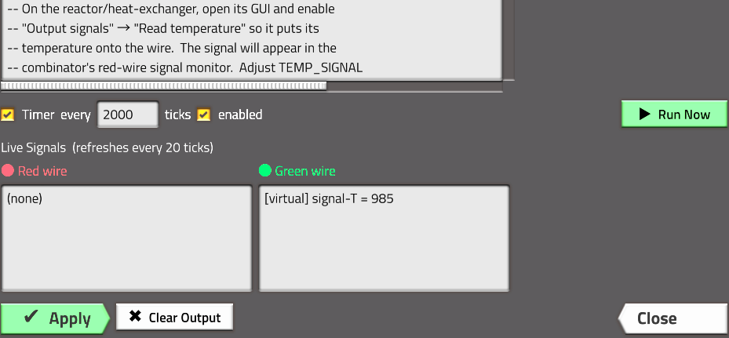

# Lua Combinator

A Factorio 2.0 mod that adds a programmable combinator. Place it, open it,
write Lua: read the red and green wires, keep state, react to game events,
send signals across the map without wires, and drive the output.



- **40+ built-in examples** in an in-game browser — clocks, memory cells,
  train limits, mall recipe selection, PID control, enemy radar, wireless
  links, a Game of Life display and more. See [EXAMPLES.md](./EXAMPLES.md).
- **A real API**: quality-aware inputs and outputs, edge detection,
  hysteresis, moving averages, PID, alerts, floating labels, wireless
  channels, shared memory. See [API_REFERENCE.md](./API_REFERENCE.md).
- **Event-driven scripts**: `script.on_event` / `on_nth_tick` for any game
  event, with any number of combinators listening.
- **Built to scale**: only combinators that are due on a tick are touched,
  code is compiled once, inputs are read only when used, and outputs are
  written only when they change.
- **Blueprint-friendly**: code and settings travel with blueprints,
  copy/paste settings and cloning.

## Quick start

1. Research **Lua Combinator** (after *Circuit network*).
2. Place one and wire its inputs and outputs like any combinator.
3. Open it. Pick an example from the **Examples** list and press **Load**,
   or write your own:

   ```lua
   local iron = get_signal("iron-plate")
   if iron < 100 then
       out("signal-red", 1)
       alert(rich_text("iron-plate") .. " is low")
   end
   ```

4. Press **Apply**. The code runs every *N* ticks (the interval next to
   **Timer**). Uncheck **Timer** for scripts that should only react to events.

The editor shows live input and output signals, your script's `storage`,
run/error counters, and an API cheat sheet. Errors appear with line numbers
and a warning icon over the combinator; the game keeps running.

## Mod settings

| Setting | Default | |
|---|---:|---|
| Default interval | 20 ticks | Interval for newly placed combinators. |
| Show error marker | on | Warning icon above failing combinators. |
| Announce script errors in chat | off | Message with a map link when a script starts failing. |

## How it works

| File | Purpose |
|---|---|
| [`control.lua`](./control.lua) | Entry point: wires Factorio events to the modules below. |
| [`scripts/scheduler.lua`](./scripts/scheduler.lua) | Tick buckets. Each combinator sits in the bucket for the tick it next runs on, so per-tick cost depends on how many are *due*, not how many exist. |
| [`scripts/sandbox.lua`](./scripts/sandbox.lua) | The script API, compile cache and execution modes. Code is compiled once as `local _ENV = ...; <code>` and called with a fresh environment each run. |
| [`scripts/outputs.lua`](./scripts/outputs.lua) | Output buffers → decider combinator parameters, written only when changed. |
| [`scripts/events.lua`](./scripts/events.lua) | One event multiplexer for the mod and every script, kept in sync with what `on_load` rebuilds so multiplayer joins never see mismatched handlers. |
| [`scripts/registry.lua`](./scripts/registry.lua) | Combinator records, blueprints, paste, cloning, migration, error markers. |
| [`scripts/signals.lua`](./scripts/signals.lua) | Reading circuit networks, signal keys and types, rich text. |
| [`scripts/gui.lua`](./scripts/gui.lua) | The editor window and example browser. |
| [`scripts/remote.lua`](./scripts/remote.lua) | `remote.call("lua-combinator", ...)` interface for bulk management. |
| [`examples/`](./examples) | Built-in examples; [`examples/index.lua`](./examples/index.lua) is the catalogue. |
| [`data.lua`](./data.lua), [`settings.lua`](./settings.lua) | Prototypes (a tinted copy of the decider combinator, item, signal, recipe, technology) and mod settings. |
| [`tests/`](./tests) | Headless test suite against a mock Factorio runtime. |

The combinator is a re-skinned decider combinator: its outputs are written
as constant outputs behind an always-true condition.

**Recipe:** 1 constant combinator + 1 advanced circuit.
**Technology:** requires *Circuit network*; 150 × automation + logistic
science, 30 s each.

### Determinism

Factorio multiplayer needs every peer to compute exactly the same thing.
The runtime keeps all script state in `storage`, gives each timer run a
fresh environment, runs handlers in a fixed order, serializes error values
deterministically, and runs the handler-registration pass with no access to
the game so it registers the same handlers on **Apply** and after a load.

## Development

The test suite loads the real `control.lua` against a mock of the Factorio
API and runs every example:

```bash
pip install lupa
```

```bash
python3 tests/run.py
```

or, with a Lua 5.2 interpreter installed, `lua5.2 tests/run_tests.lua`.
